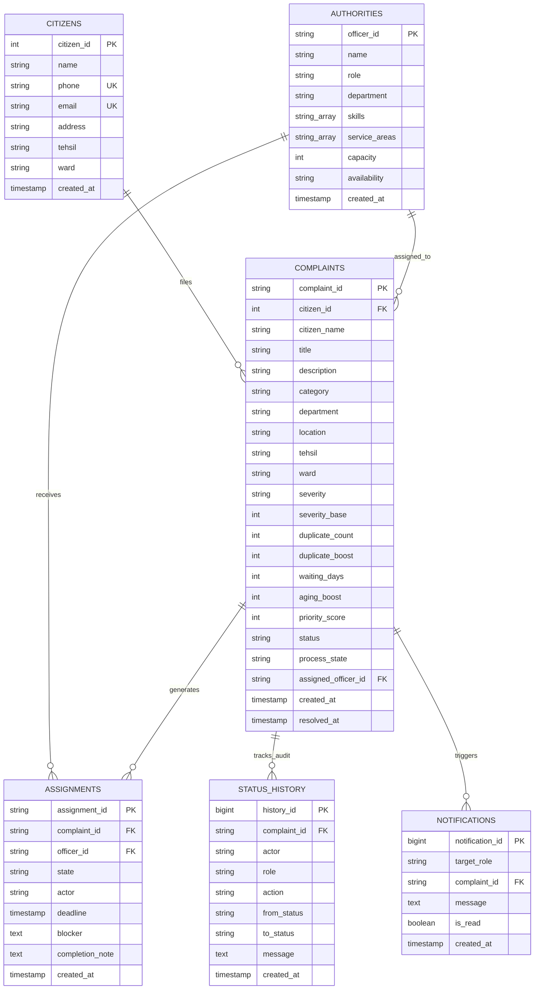

# Civic Smart — PostgreSQL DBMS Implementation & Setup Guide

**Project Title:** Civic Smart — An OS & DBMS Municipal Grievance Management System (Dehradun)  
**Module:** PostgreSQL Relational Database Management System (DBMS) & Backend Integration  

---

## 1. Project Analysis & DBMS Architecture

Civic Smart models city complaints as **Processes** managed through an **Operating System Priority Scheduler** and stored persistently inside a **PostgreSQL Relational Database**.

### 1.1 Relational Entity-Relationship Diagram (ERD)



---

## 2. What Has Been Created in Your Project

| Component | File / Location | Purpose |
| :--- | :--- | :--- |
| **Complete DDL Schema** | [`database/schema.sql`](file:///c:/Users/suhan/OneDrive/Desktop/Projects/Civic_smart/Civic_smart/database/schema.sql) | DDL for all 6 tables, primary/foreign keys, check constraints, composite B-tree indexes, triggers (`fn_recalculate_complaint_priority`, `fn_audit_complaint_status_change`), stored procedures (`sp_simulate_daily_aging`, `sp_allocate_officer`), and 4 analytical views. |
| **Initial Seed Data** | [`database/seed_data.sql`](file:///c:/Users/suhan/OneDrive/Desktop/Projects/Civic_smart/Civic_smart/database/seed_data.sql) | Pre-populated realistic records for Citizens, Officers, Complaints (CS1060, CS1024, etc.), Assignments, and Audit trail matching Dehradun wards. |
| **Catalog of Queries** | [`database/queries.sql`](file:///c:/Users/suhan/OneDrive/Desktop/Projects/Civic_smart/Civic_smart/database/queries.sql) | Curated SQL queries for Citizen tracking, Authority triage, Officer portal worklists, MLQ scheduler extraction, and SLA governance analytics. |
| **Node.js REST Backend** | [`backend/server.js`](file:///c:/Users/suhan/OneDrive/Desktop/Projects/Civic_smart/Civic_smart/backend/server.js), [`backend/db.js`](file:///c:/Users/suhan/OneDrive/Desktop/Projects/Civic_smart/Civic_smart/backend/db.js), [`backend/package.json`](file:///c:/Users/suhan/OneDrive/Desktop/Projects/Civic_smart/Civic_smart/backend/package.json) | Complete Express REST API connecting to PostgreSQL with pool diagnostics and endpoints for all actions. |
| **Python REST Backend** | [`backend/python/app.py`](file:///c:/Users/suhan/OneDrive/Desktop/Projects/Civic_smart/Civic_smart/backend/python/app.py), [`backend/python/requirements.txt`](file:///c:/Users/suhan/OneDrive/Desktop/Projects/Civic_smart/Civic_smart/backend/python/requirements.txt) | Turnkey Flask + `psycopg2` alternative backend for users who prefer Python over Node.js. |
| **Client Integration Bridge** | [`js/civic-api.js`](file:///c:/Users/suhan/OneDrive/Desktop/Projects/Civic_smart/Civic_smart/js/civic-api.js) | Dual-write client module that talks to PostgreSQL when backend is active, and transparently falls back to `localStorage` when offline. |
| **1-Click Setup Script** | [`setup_database.bat`](file:///c:/Users/suhan/OneDrive/Desktop/Projects/Civic_smart/Civic_smart/setup_database.bat) | Automated Windows batch wizard to create the database, apply the schema, and insert seed data. |

---

## 3. Preservation Guarantee (Why Your Existing Site Never Breaks)

> [!NOTE]
> **No breaking changes:** All original HTML and JS functionality is 100% preserved.  
> If the PostgreSQL server or backend API is **not running**, the application automatically stays in standalone browser demo mode (`localStorage`), with an orange status pill indicating `Offline Demo (localStorage)`.  
> Once you start PostgreSQL and the backend server, the app detects it within seconds, updates the topbar badge to green `PostgreSQL Live: civic_smart_db`, and begins syncing live data!

---

## 4. EXACT STEPS YOU MUST PERFORM MANUALLY

Because PostgreSQL requires local Windows credentials and a running service on your machine, follow these manual steps to connect:

```
┌────────────────────────────────────────────────────────┐
│               MANUAL WORKFLOW CHECKLIST                │
├────────────────────────────────────────────────────────┤
│ [ ] Step 1: Ensure PostgreSQL Windows Service is Active│
│ [ ] Step 2: Create Database "civic_smart_db"           │
│ [ ] Step 3: Run Schema & Seed SQL Files                │
│ [ ] Step 4: Configure backend/.env Password            │
│ [ ] Step 5: Start the Backend Server (Node or Python)  │
│ [ ] Step 6: Verify in Browser                          │
└────────────────────────────────────────────────────────┘
```

---

### Step 1: Ensure PostgreSQL Service is Running

1. If you haven't installed PostgreSQL yet, download the installer for Windows from:  
   👉 [https://www.postgresql.org/download/windows/](https://www.postgresql.org/download/windows/)  
   *(Default port is `5432` and default superuser is `postgres`)*

2. If PostgreSQL is already installed on your machine (e.g., PostgreSQL 18 at `C:\Program Files\PostgreSQL\18`):
   - Open PowerShell and verify the service:
     ```powershell
     Get-Service -Name *postgres*
     ```
   - If the status is `Stopped`, start it:
     ```powershell
     Start-Service postgresql-x64-18
     ```

---

### Step 2 & 3: Create the Database & Load Schema / Seed Data

You have **two options** to perform this:

#### Option A: Using the Provided 1-Click Batch Wizard (Recommended)
1. Double-click [`setup_database.bat`](file:///c:/Users/suhan/OneDrive/Desktop/Projects/Civic_smart/Civic_smart/setup_database.bat) in your project root.
2. Enter your `postgres` password when prompted.
3. The wizard will automatically:
   - Create `civic_smartdb` (if it does not exist)
   - Execute [`database/schema.sql`](file:///c:/Users/suhan/OneDrive/Desktop/Projects/Civic_smart/Civic_smart/database/schema.sql)
   - Execute [`database/seed_data.sql`](file:///c:/Users/suhan/OneDrive/Desktop/Projects/Civic_smart/Civic_smart/database/seed_data.sql)

#### Option B: Manual Command Line (PowerShell / Command Prompt)
Run the following commands:
```powershell
# Set psql path (use your installed version):
$env:PATH += ";C:\Program Files\PostgreSQL\18\bin"

# 1. Create database:
psql -U postgres -c "CREATE DATABASE civic_smartdb;"

# 2. Run schema:
psql -U postgres -d civic_smartdb -f database\schema.sql

# 3. Run seed data:
psql -U postgres -d civic_smartdb -f database\seed_data.sql
```

#### Option C: Using pgAdmin 4 (GUI)
1. Open **pgAdmin 4** from your Start menu.
2. Right-click **Databases** -> **Create** -> **Database...** -> Name it `civic_smartdb` -> Click **Save**.
3. Right-click `civic_smartdb` -> select **Query Tool**.
4. Open and execute [`database/schema.sql`](file:///c:/Users/suhan/OneDrive/Desktop/Projects/Civic_smart/Civic_smart/database/schema.sql) (Press `F5`).
5. Open and execute [`database/seed_data.sql`](file:///c:/Users/suhan/OneDrive/Desktop/Projects/Civic_smart/Civic_smart/database/seed_data.sql) (Press `F5`).

---

### Step 4: Configure the Backend Environment File

Navigate into the `backend/` folder:
1. Make a copy of `.env.example` named `.env`:
   ```powershell
   cd backend
   copy .env.example .env
   ```
2. Open `backend/.env` and update `PGPASSWORD` with your PostgreSQL password:
   ```env
   PORT=5000
   PGHOST=localhost
   PGPORT=5432
   PGDATABASE=civic_smartdb
   PGUSER=postgres
   PGPASSWORD=your_actual_password_here
   ```

---

### Step 5: Start the Backend REST API Server

Choose either **Node.js** or **Python**:

#### If you use Node.js:
Open a terminal in `backend/`:
```powershell
cd backend
npm install
npm start
```
You will see:
```text
========================================================
 CIVIC SMART - POSTGRESQL REST API BACKEND
 Running on: http://localhost:5000
 Health check: http://localhost:5000/api/health
========================================================
```

#### If you use Python:
Open a terminal in `backend/python/`:
```powershell
cd backend\python
pip install -r requirements.txt
python app.py
```

---

### Step 6: Verify in Your Browser

1. Serve the frontend with any static server or open `admin.html`:
   ```powershell
   py -m http.server 8000
   ```
2. Open `http://localhost:8000/admin.html` in your browser.
3. Look at the top-right header:
   - When connected to PostgreSQL, the pill turns green:  
     🟢 **PostgreSQL Live: civic_smartdb**
4. Submit a new complaint on `report.html`:
   - It will save into the PostgreSQL `complaints` table, calculate priority scores via PostgreSQL triggers, and immediately show up in the Admin portal!

---

## 5. PostgreSQL Schema Details & Specifications

### 5.1 Tables Created

| Table Name | Primary Key | Foreign Keys | Key Constraints |
| :--- | :--- | :--- | :--- |
| `citizens` | `citizen_id` (SERIAL) | None | Unique `phone`, unique `email`, non-empty name |
| `authorities` | `officer_id` (VARCHAR) | None | `capacity >= 1`, `availability` enum (`Available`, `Busy`, `On Leave`) |
| `complaints` | `complaint_id` (VARCHAR) | `citizen_id` &rarr; `citizens`, `assigned_officer_id` &rarr; `authorities` | `category` check, `severity` check, `priority_score BETWEEN 0 AND 100`, `status` check |
| `assignments` | `assignment_id` (VARCHAR) | `complaint_id` &rarr; `complaints`, `officer_id` &rarr; `authorities` | `state` enum (`PENDING_ACCEPTANCE`, `ACCEPTED`, `IN_PROGRESS`, `BLOCKED`, `COMPLETION_SUBMITTED`, etc.) |
| `status_history` | `history_id` (BIGSERIAL) | `complaint_id` &rarr; `complaints` | `role` enum (`CITIZEN`, `ADMIN`, `OFFICER`, `SYSTEM`) |
| `notifications` | `notification_id` (BIGSERIAL) | `complaint_id` &rarr; `complaints` | `target_role` enum |

### 5.2 Dynamic Priority Score Formula (Implemented in Stored Trigger)

$$\text{Priority Score} = \text{Base Severity} + \text{Duplicate Boost} + \text{Aging Boost}$$

- **Base Severity**: `Critical` (90), `High` (75), `Medium` (60), `Low` (40)
- **Duplicate Boost**: $\max(0, \text{duplicate\_count} - 1) \times 2$
- **Aging Boost**: $\text{waiting\_days} \times 2$
- **Queue Lane**:
  - `Queue 0 (Critical)`: Score $\ge 85$
  - `Queue 1 (High Urgency)`: $70 \le \text{Score} < 85$
  - `Queue 2 (Standard Routine)`: $\text{Score} < 70$

Whenever a complaint is created or modified in PostgreSQL, trigger `trg_complaints_priority_calc` automatically computes the score and sets `process_state`.

### 5.3 Automated Audit Trail Trigger

Whenever a complaint's `status` changes:
- Trigger `trg_complaints_status_audit` executes automatically.
- A new row is appended to `status_history` recording the previous status, next status, actor, timestamp, and message.
- A citizen alert is inserted into `notifications`.

---

## 6. Useful Queries Quick Reference

All queries are documented in [`database/queries.sql`](file:///c:/Users/suhan/OneDrive/Desktop/Projects/Civic_smart/Civic_smart/database/queries.sql). Here are key examples:

### 1. View Multilevel Ready Queue (MLQ)
```sql
SELECT complaint_id, title, category, priority_score, mlq_lane, mlq_tier_name, status 
FROM vw_priority_queue_mlq;
```

### 2. View Officer Workload & Capacity Utilization
```sql
SELECT officer_name, role, department, active_assignments, max_capacity, utilization_percent 
FROM vw_officer_workload;
```

### 3. Ward Hotspot Density Report (Dehradun)
```sql
SELECT tehsil, ward, total_complaints, pending_complaints, critical_pending, avg_priority_score, resolution_rate_percent 
FROM vw_ward_hotspots;
```

### 4. Trigger Daily Aging Simulation (OS Anti-Starvation Step)
```sql
CALL sp_simulate_daily_aging();
```

### 5. Allocate Officer via Workload-Aware Dispatcher
```sql
CALL sp_allocate_officer('CS1060', 'Authority Console');
```

---

## 7. Troubleshooting Guide

| Issue | Cause | Solution |
| :--- | :--- | :--- |
| `psql : The term 'psql' is not recognized` | PostgreSQL `bin` directory is not in your Windows PATH. | Add `C:\Program Files\PostgreSQL\18\bin` to PATH, or use `setup_database.bat` which auto-detects it. |
| `password authentication failed for user "postgres"` | Incorrect password in `.env` or during setup. | Open `backend/.env` and verify `PGPASSWORD`. In `psql`, use the password set when installing PostgreSQL. |
| `database "civic_smartdb" does not exist` | Database has not been created yet. | Run `psql -U postgres -c "CREATE DATABASE civic_smartdb;"` or use `setup_database.bat`. |
| `connection refused / could not connect to server` | PostgreSQL Windows Service is not running. | Run `Start-Service postgresql-x64-18` in an Administrator PowerShell window. |
| `ERROR: column "ward" does not exist (SQLSTATE 42703)` | Pre-existing table in PostgreSQL was created without the `ward` column. `CREATE TABLE IF NOT EXISTS` skips altering existing tables. | Run `psql -U postgres -d civic_smartdb -f database\migration_add_ward_columns.sql` or re-run `schema.sql` (which now includes safe inline migrations). |
| Status pill shows `Offline Demo (localStorage)` | Backend server (`http://localhost:5000`) is not running. | Run `npm start` in `backend/` or `python app.py` in `backend/python/`. |
